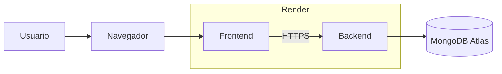

# TP Desarrollo de Aplicaciones - Sweet Medical

## Grupo N° 3

### Integrantes
- **Nahuel Saez**
- **Nicolás Reinoso**
- **Nahuel Darsaut**
- **Lucas Chague**

---

## Sobre el proyecto

**Sweet Medical** es un sistema web para la gestión de turnos médicos. Permite administrar médicos, pacientes, disponibilidades, prácticas, coberturas y el ciclo de vida de los turnos (reserva, modificación, cancelación y notificaciones).

---

## Tecnologías

| Capa | Tecnologías |
|------|-------------|
| **Frontend** | React, Axios, React Router, Bootstrap |
| **Backend** | Node.js, Express, Mongoose, JWT, Swagger |
| **Base de datos** | MongoDB |
| **Infraestructura** | Docker, Docker Compose, Render, MongoDB Atlas |

---

## Arquitectura

El proyecto está dividido en tres servicios independientes:



**Capas del backend:**

```
Routes → Controllers → Services → Repositorio → Models
```
---

## Despliegue local

### Requisitos

- [Docker](https://www.docker.com/) instalado

### Pasos

1. Clonar el repositorio:

```bash
git clone https://github.com/ddsw-man/2026-1c-backend-grupo-03.git
cd 2026-1c-backend-grupo-03
```

2. Verificar las variables de entorno del backend en `backend/.env.docker`:

```env
MONGO_URI=mongodb://mongo:27017/BD-SweetMedical
PORT=3001
JWT_SECRET=<tu-clave-secreta>
```

3. Levantar los servicios:

```bash
docker compose up --build
```

4. Acceder a la aplicación:

| Servicio | URL |
|----------|-----|
| Frontend | http://localhost:3000 |
| Backend (API) | http://localhost:3001 |
| Swagger (docs) | http://localhost:3001/api-docs |
| Health check | http://localhost:3001/health |

### Notas locales

- La primera vez que se levanta MongoDB, `mongo-init.js` carga datos de prueba automáticamente.
- El frontend se conecta al backend mediante `REACT_APP_API_URL=http://localhost:3001` (configurado en `docker-compose.yaml`).

---

## Despliegue en la nube (Render + MongoDB Atlas)

### Requisitos

- Repositorio del proyecto en GitHub
- Cuenta en [Render](https://render.com/)
- Cuenta en [MongoDB Atlas](https://www.mongodb.com/atlas)
- Variables de entorno configuradas en Render

### 1. Crear la base de datos (MongoDB Atlas)

1. Crear un clúster en MongoDB Atlas.
2. Crear un usuario con permisos sobre la base de datos.
3. Configurar **Network Access** para permitir conexiones desde cualquier IP (`0.0.0.0/0`) o desde Render.
4. Obtener la cadena de conexión. Debe incluir el nombre de la base de datos `BD-SweetMedical`:

```
mongodb+srv://<usuario>:<password>@<cluster>.mongodb.net/BD-SweetMedical?appName=<appName>
```

### 2. Desplegar el Backend

1. Crear un **Web Service** en Render.
2. Conectar el repositorio de GitHub.
3. Configurar:

| Campo | Valor |
|-------|-------|
| **Root Directory** | `backend/` |
| **Environment** | Docker |
| **Docker target** | `production` |

4. Variables de entorno:

| Variable | Descripción |
|----------|-------------|
| `PORT` | Puerto de ejecución (`3001`) |
| `MONGO_URI` | Cadena de conexión a MongoDB Atlas |
| `JWT_SECRET` | Clave super secreta para la generación de tokens JWT |

5. Esperar a que el servicio quede en estado **Live**.

### 3. Desplegar el Frontend

1. Crear un **Web Service** en Render.
2. Conectar el repositorio de GitHub.
3. Configurar:

| Campo | Valor |
|-------|-------|
| **Root Directory** | `frontend/` |
| **Environment** | Docker |
| **Docker target** | `production` |

4. Variables de entorno:

| Variable | Descripción |
|----------|-------------|
| `REACT_APP_API_URL` | URL pública del backend en Render (ej: `https://two026-1c-backend-grupo-03.onrender.com`) |

> **Importante:** `REACT_APP_API_URL` se embebe en el build del frontend. Si cambia la URL del backend, hay que volver a desplegar el frontend.

5. Esperar a que el servicio quede en estado **Live**.

### Diagrama de arquitectura en la nube [Diagrama](https://app.eraser.io/workspace/kTypJyckF2By9zUU7ltW?origin=share)

### Publicar nuevas versiones

Render detecta el nuevo commit (actualmente en la rama Entrega-4) y despliega automáticamente los servicios afectados.
